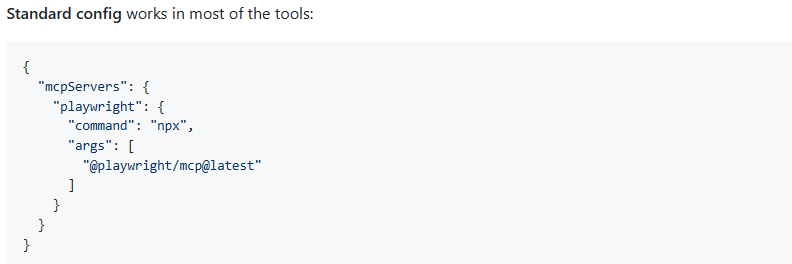
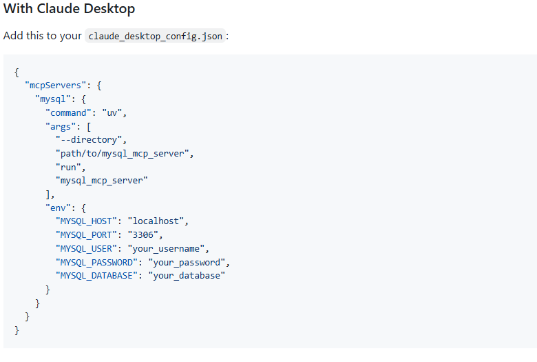
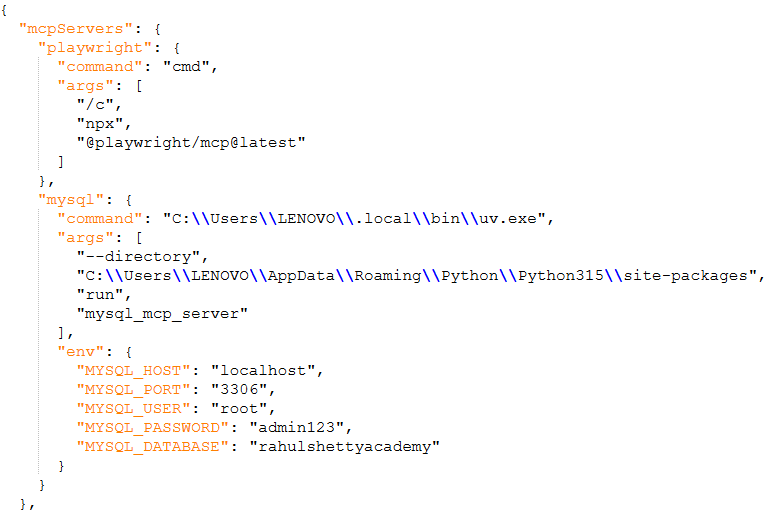

# 1. What is MCP (Model Context Protocol)?

**Model Context Protocol (MCP)** is an open, standardized protocol created to connect Large Language Models (LLMs) to external data sources, local systems, and software tools securely and uniformly. MCP (Model Context Protocol) is a standardized way for an LLM (or AI agent) to talk to external tools and data sources—like a database, local/repo files, or Jira.

* **Before MCP:** Every AI tool integration was a custom job. If you wanted an LLM to read a database, run browser tests, or access local files, developers had to write custom API wrappers, handle security manually, and build bespoke connections for every single tool.
* **With MCP:** It creates a universal **client-server standard**. The LLM acts as the client, and external systems (like databases, browsers, or file systems) run as standardized MCP servers.

---

# What is the Purpose of MCP in Simple Words?

The main purpose of **MCP (Model Context Protocol)** is to give AI a **standardized set of hands and eyes (tools)** so it can interact with the real world safely and easily.

Without MCP, an AI is like a brilliant advisor stuck behind glass—it can give you advice, but it can't touch anything. To get it to do real work (like running a test script or querying a database), developers had to build custom, complicated bridge code for every single tool.

---

### The 3 Core Purposes:

1. **Stop Copy-Pasting and Scripting (Universal Plug-and-Play)**  
   * **Purpose:** Make tools "plug-and-play" for AI.  
   * Instead of building customized connections for Playwright, MySQL, Jira, and local files separately, MCP creates **one universal adapter**. Once a tool is wrapped in an MCP server, any AI model can immediately use it.

2. **Turn AI from a "Talker" into a "Doer" (Autonomous Action)**  
   * **Purpose:** Allow AI to perform multi-step actions directly in real systems.  
   * Instead of telling *you* how to test a web app, the AI uses MCP to open the browser itself, execute the steps, check the database backend, and output the log file on its own.

3. **Keep Access Safe and Controlled (Security)**  
   * **Purpose:** Ensure the AI only sees and touches what you explicitly allow.  
   * MCP acts as a secure boundary. The AI doesn't get unrestricted access to your computer; it can only request specific actions defined in your MCP settings file (like "run SQL query" or "click DOM element").
4. **Security & Control**  
   Ensures standard security boundaries. The AI cannot access systems arbitrarily; it can only invoke predefined functions exposed by explicitly configured MCP servers.

   


   # Why MCP Server are required

   An AI model on its own cannot directly talk to external tools like a browser, a database, an Excel sheet, APIs, or your computer's files. MCP Servers act as the middleman (or translator) between the AI and each specific tool.

   Looking at the diagram flow (Claude LLM → MCP Servers → Web Browser / Database / Excel Files / External APIs / File System), MCP servers are required because:

   1. They translate AI requests into real tool actions: The AI decides what needs to be done (like checking a database or reading a file), and the right MCP server (like MySQL MCP or Filesystem MCP) translates that into actual commands for that tool.
   2. They keep each tool separate and organized: Instead of stuffing every tool's logic into the AI, each tool has its own MCP server (such as Playwright MCP, MySQL MCP, REST API MCP, Excel MCP, and Filesystem MCP).
   3. They create a standard connection: Once a tool has an MCP server, the AI can connect to it in a clean, consistent way—configured through the MCP configuration file—without custom glue code for every single workflow.

   # When do we need MCP

   We don't need every data source wrapped in an MCP server. When an MCP server makes total sense vs. when it's unnecessary overhead.

   **When Do You Need MCP vs. When Is It Overkill?**

   **Step 1**: Check if an LLM actually needs live, interactive access

   - **Overkill**: You just need to summarize 5 Jira tickets or inspect one log file once a week. Copy-pasting or exporting a CSV/JSON and dropping it into chat is faster and safer.

   - **Worth considering MCP**: Your team or AI agents repeatedly look up fresh data across tools during investigations, test planning, or triage.

   **Step 2**: Check how many tools and AI clients are involved

   - **Overkill**: You have one simple internal script and one AI tool you use personally. A direct function call or small script is plenty.

   - **Worth considering MCP**: You want multiple AI assistants/agents (IDE assistants, internal chat agents, CI/CD helper bots) to query Jira, test logs, and a database using the same clean interface without rewriting integrations each time.

   **Step 3**: Check safety, scoping, and repeatability

   - **Overkill**: Giving an LLM raw, unrestricted access to a production database via MCP just to "see what's there."

   - **Worth considering MCP**: You want a controlled, read-only, purpose-built boundary—for example, exposing safe parameterized queries or masked fields rather than letting a prompt invent arbitrary SQL or read sensitive secrets.

   **Step 4**: Check maintenance cost vs. time saved

   - **Overkill**: A toy proof-of-concept or a workflow that changes every week.

   - **Worth considering MCP**: A workflow your QA team runs dozens of times a week where manual context-switching wastes real engineering time.

   **MCP is worth considering when your team or AI needs to repeatedly collect information from multiple tools to complete a task.**

   For example, imagine you are investigating a production defect.

   You need information from:
   - Jira – To check defect details.
   - Confluence – To check requirements and technical documentation.
   - Test Management Tool – To check test execution results.
   - Customer Support System – To check customer-reported issues.
   Normally, you would open each tool, search for information, collect the results, and analyse them yourself.

   With MCP, an AI application can connect to these tools through MCP servers and use the available tools to retrieve information

   # Real-world example

   ```
   Scenario: Investigating a production defect a customer reports - "After the latest deployment, customers are unable to complete payments."
   ```
   1. You ask Claude - "Investigate this payment issue and identify potential reasons."
   2. Claude (AI Agent) Understands the request and decides what information it needs.
   3. MCP connects Claude to different tools
      - JIRA (Related Defects)
      - Confluence (Requirements)
      - Test Management (Execution Results)
      - Customer Support (Customer Complaints)
   4. Claude analyses the collected information
      - Finds related defects.
      - Identifies common failure patterns.
      - Compares recent test execution results.
      - Checks whether the latest release introduced the issue.
   
   ```
   Final output from Claude:

   "Payment failures appear related to the latest payment gateway integration change. Three related defects were reported, and regression testing did not cover one affected payment workflow."
   ```

   # Why is MCP useful here?
   Without MCP:
   1. Open Jira.
   2. Search for payment-related defects.
   3. Open Confluence.
   4. Search for payment requirements.
   5. Open test reports.
   6. Compare all the information manually.
   7. Prepare your investigation report.

   With MCP:
   1. Ask Claude to investigate.
   2. Claude accesses the connected tools through MCP.
   3. Claude collects the required information.
   4. Claude analyses the information.
   5. Claude provides a consolidated report.

   # When should a QA Architect consider MCP?

   | QA Activity | How MCP Helps |
   | :--- | :--- |
   | Defect Triage | Retrieves related defects from Jira and helps AI analyse defect patterns. |
   | Test Planning | Retrieves requirements and existing test cases from connected tools to help AI identify test coverage gaps. |
   | Release Readiness | Collects open defects, test execution status, and unresolved risks to help AI assess release readiness. |
   | Customer Escalation | Retrieves customer complaints, support cases, and related defects to help AI investigate customer-impacting issues. |
   | Quality Reporting | Collects quality-related information from multiple sources to help AI prepare consolidated quality reports. |
   | Regression Planning | Retrieves historical test execution results and defect information to help AI identify suitable regression test scenarios. |

   # Remember these 3 concepts:

   | Concept | Simple Explanation | Responsibility |
   | :--- | :--- | :--- |
   | **AI Agent (Claude)** | The brain that understands the request, decides what to do, and analyses the results. | Performs reasoning, analysis, and decision-making. |
   | **MCP (Model Context Protocol)** | A standard communication mechanism that allows AI applications to connect to external tools and access their capabilities. | Enables communication between AI applications and external tools. |
   | **External Tools (Jira, Confluence, etc.)** | The actual sources of information that the AI needs to perform a task. | Store and provide information such as defects, requirements, test cases, and execution results. |

   ### How They Work Together

   1. **AI Agent:** Understands the user's request and determines what information is needed.
   2. **MCP:** Enables the AI Agent to communicate with external tools.
   3. **External Tools:** Provide the requested information to the AI Agent.
   4. **AI Agent:** Analyses the collected information and generates the final output.

   ### Important Takeaway

   - MCP itself does not analyse defects or make decisions.
   - MCP does not store the actual business information.
   - MCP provides a standard way for AI applications to communicate with external tools.
   - The AI Agent performs the reasoning and analysis using the information retrieved from those tools.

   **In simple words:**
   - AI Agent = Brain
   - MCP = Communication Bridge
   - External Tools = Sources of Information

   # Playwright MCP Server

   Playwright MCP Server lets the AI (like Claude LLM) directly open and control a Web Browser (such as Chrome or Edge) to test websites and web apps. **This MCP server exposes tools to automate browser interactions directly from your AI agent.** It provides a set of tools for browser automation.

   - Without Playwright MCP: The AI can only write Playwright test code for you. You still have to copy the code, save it, run it yourself, and figure out why it failed.
   - With Playwright MCP: The AI can actually open the browser, click buttons, type text into forms, navigate pages, and check what appears on screen on its own.

   For a QA engineer, this means you can ask the AI in plain English—for example, "Open the login page, try logging in with a wrong password, and tell me what error message shows up"—and it can perform that browser check directly.

   How to start server - See the [Playwright MCP](https://github.com/microsoft/playwright-mcp) for more details.

   

   # MySQL MCP Server

   See the [MySQL MCP](https://github.com/designcomputer/mysql_mcp_server)

   

   1. We 1st need to install mysql-mcp-server as mentioned under the document above
   2. Manual installation - pip install mysql-mcp-server [python must be installed and its path must be set]
   3. Check its path and copy - pip show mysql-mcp-server
   4. Once installed then provide the path ["path/to/mysql_mcp_server"]
   5. Install uv - pip install uv
   6. Check its path and copy- where uv
   7. Download and Install mysql server and do the necessary configurations
   8. Run SQLQueries to ensure DB exists along with data
   9. Once eveyrhing confirms then paste the entires under mcp server config file

   ```
   scott
   localhost
   admin123
   port 3306


   username=root
   password=admin123
   ```

   

   ```
   "mysql": {
      "command": "C:\\Users\\LENOVO\\.local\\bin\\uv.exe",
      "args": [
        "--directory",
        "C:\\Users\\LENOVO\\AppData\\Roaming\\Python\\Python315\\site-packages",
        "run",
        "mysql_mcp_server"
      ],
      "env": {
        "MYSQL_HOST": "localhost",
        "MYSQL_PORT": "3306",
        "MYSQL_USER": "root",
        "MYSQL_PASSWORD": "admin123",
        "MYSQL_DATABASE": "rahulshettyacademy"
      }
    }
   ```

   # REST API MCP Server

   See the [Rest API MCP](https://github.com/dkmaker/mcp-rest-api)

   1. Create a dedicated folder to store all files so the MCP server can access them. For example- files_claude
   2. Place files "EcomBasic.postman_collection.json" at this folder just for testing purpose

   ```
   "rest-api": {
		"command": "npx",
		"args": [
			"-y",
			"dkmaker-mcp-rest-api"
		],
		"env": {
			"REST_BASE_URL": "https://rahulshettyacademy.com",
			"HEADER_Accept": "application/json"
		}
	},
   ```

   # File System MCP Server

   See the [File System MCP](https://mcpservers.org/servers/modelcontextprotocol/filesystem)

   1. Create a dedicated folder to store all files so the MCP server can access them. For example- files_claude
   2. Place both files "sample_employee_records.csv" and "sample_employee_records.xlsx" at this folder just for testing purpose
   
   

   ```
   "filesystem": {
      "command": "cmd",
      "args": [
        "/c",
        "npx",
        "-y",
        "@modelcontextprotocol/server-filesystem",
        "C:\\Users\\LENOVO\\files_claude"
      ]
    }
   ```

   # Excel MCP Server

   See the [Excel MCP](https://github.com/negokaz/excel-mcp-server)

   ```
   "excel": {
		"command": "npx",
		"args": ["--yes", "@negokaz/excel-mcp-server"],
		"env": {
			"EXCEL_MCP_PAGING_CELLS_LIMIT": "4000"
		}
	},
   ```
`Testing at Claude`

```
- By Name or ID: "Find the row for EMP-1003 or Priya Patel in the Excel sheet."

- By Department & Salary: "Show everyone in Finance and their annual salary from the sample Excel file."

- By Status: "Which employees in the Excel records are currently On Leave?"

- Add a new employee to sample_employee_records.csv: Name: Alex Morgan, ID: EMP-1011, Department: Engineering, Title: Lead Developer, Hire Date: 2024-01-15, Salary: $125,000, Status: Active.

- Add 5 new sample records to sample_employee_records.csv with realistic employee data for the Marketing and Finance departments.

- Append a new row to sample_employee_records.xlsx on the 'Employee Directory' sheet for a new Sales Manager earning $98,000.

- Read sample_employee_records.xlsx from the MCP folder, add two new rows for new hires in Human Resources, and save the updated spreadsheet back to the same file
```