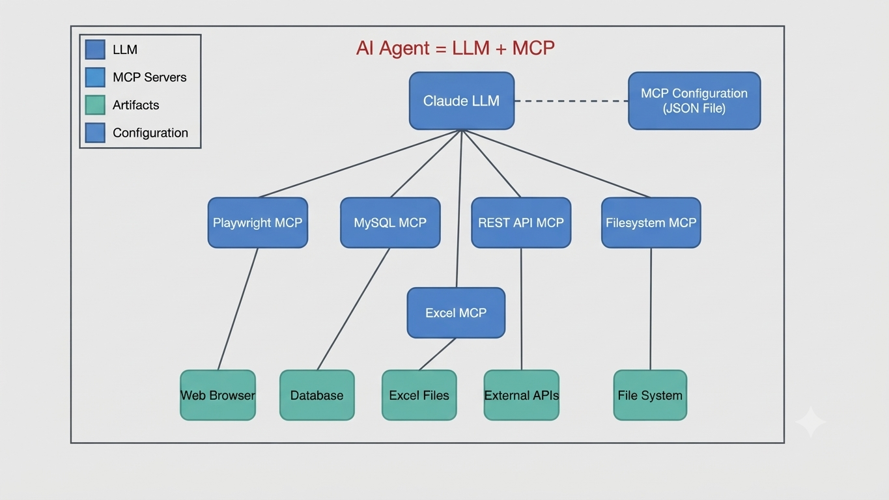

# 1. What is MCP (Model Context Protocol)?

**Model Context Protocol (MCP)** is an open, standardized protocol created to connect Large Language Models (LLMs) to external data sources, local systems, and software tools securely and uniformly.

* **Before MCP:** Every AI tool integration was a custom job. If you wanted an LLM to read a database, run browser tests, or access local files, developers had to write custom API wrappers, handle security manually, and build bespoke connections for every single tool.
* **With MCP:** It creates a universal **client-server standard**. The LLM acts as the client, and external systems (like databases, browsers, or file systems) run as standardized MCP servers.

---

# What is the Purpose of MCP in Simple Words?

The main purpose of **MCP (Model Context Protocol)** is to give AI a **standardized set of hands and eyes (tools)** so it can interact with the real world safely and easily.

Without MCP, an AI is like a brilliant advisor stuck behind glass—it can give you advice, but it can't touch anything. To get it to do real work (like running a test script or querying a database), developers had to build custom, complicated bridge code for every single tool.

---

### The 3 Core Purposes:

1. **Stop Copy-Pasting and Scripting (Universal Plug-and-Play)**  
   * **Purpose:** Make tools "plug-and-play" for AI.  
   * Instead of building customized connections for Playwright, MySQL, Jira, and local files separately, MCP creates **one universal adapter**. Once a tool is wrapped in an MCP server, any AI model can immediately use it.

2. **Turn AI from a "Talker" into a "Doer" (Autonomous Action)**  
   * **Purpose:** Allow AI to perform multi-step actions directly in real systems.  
   * Instead of telling *you* how to test a web app, the AI uses MCP to open the browser itself, execute the steps, check the database backend, and output the log file on its own.

3. **Keep Access Safe and Controlled (Security)**  
   * **Purpose:** Ensure the AI only sees and touches what you explicitly allow.  
   * MCP acts as a secure boundary. The AI doesn't get unrestricted access to your computer; it can only request specific actions defined in your MCP settings file (like "run SQL query" or "click DOM element").
4. **Security & Control**  
   Ensures standard security boundaries. The AI cannot access systems arbitrarily; it can only invoke predefined functions exposed by explicitly configured MCP servers.

   


   # Why MCP Server are required

   An AI model on its own cannot directly talk to external tools like a browser, a database, an Excel sheet, APIs, or your computer's files. MCP Servers act as the middleman (or translator) between the AI and each specific tool.

   Looking at the diagram flow (Claude LLM → MCP Servers → Web Browser / Database / Excel Files / External APIs / File System), MCP servers are required because:

   1. They translate AI requests into real tool actions: The AI decides what needs to be done (like checking a database or reading a file), and the right MCP server (like MySQL MCP or Filesystem MCP) translates that into actual commands for that tool.
   2. They keep each tool separate and organized: Instead of stuffing every tool's logic into the AI, each tool has its own MCP server (such as Playwright MCP, MySQL MCP, REST API MCP, Excel MCP, and Filesystem MCP).
   3. They create a standard connection: Once a tool has an MCP server, the AI can connect to it in a clean, consistent way—configured through the MCP configuration file—without custom glue code for every single workflow.   

   # Playwright MCP Server

   Playwright MCP Server lets the AI (like Claude LLM) directly open and control a Web Browser (such as Chrome or Edge) to test websites and web apps. **This MCP server exposes tools to automate browser interactions directly from your AI agent.** It provides a set of tools for browser automation.

   - Without Playwright MCP: The AI can only write Playwright test code for you. You still have to copy the code, save it, run it yourself, and figure out why it failed.
   - With Playwright MCP: The AI can actually open the browser, click buttons, type text into forms, navigate pages, and check what appears on screen on its own.

   For a QA engineer, this means you can ask the AI in plain English—for example, "Open the login page, try logging in with a wrong password, and tell me what error message shows up"—and it can perform that browser check directly.

   How to start server - See the [Playwright MCP](https://github.com/microsoft/playwright-mcp) for more details.

   

   # MySQL MCP Server

   See the [MySQL MCP](https://github.com/designcomputer/mysql_mcp_server)

   

   1. We 1st need to install mysql-mcp-server as mentioned under the document above
   2. Manual installation - pip install mysql-mcp-server [python must be installed and its path must be set]
   3. Check its path and copy - pip show mysql-mcp-server
   4. Once installed then provide the path ["path/to/mysql_mcp_server"]
   5. Install uv - pip install uv
   6. Check its path and copy- where uv
   7. Download and Install mysql server and do the necessary configurations
   8. Run SQLQueries to ensure DB exists along with data
   9. Once eveyrhing confirms then paste the entires under mcp server config file

   ```
   scott
   localhost
   admin123
   port 3306


   username=root
   password=admin123
   ```

   

   ```
   "mysql": {
      "command": "C:\\Users\\LENOVO\\.local\\bin\\uv.exe",
      "args": [
        "--directory",
        "C:\\Users\\LENOVO\\AppData\\Roaming\\Python\\Python315\\site-packages",
        "run",
        "mysql_mcp_server"
      ],
      "env": {
        "MYSQL_HOST": "localhost",
        "MYSQL_PORT": "3306",
        "MYSQL_USER": "root",
        "MYSQL_PASSWORD": "admin123",
        "MYSQL_DATABASE": "rahulshettyacademy"
      }
    }
   ```

   # REST API MCP Server

   See the [Rest API MCP](https://github.com/dkmaker/mcp-rest-api)

   1. Create a dedicated folder to store all files so the MCP server can access them. For example- files_claude
   2. Place files "EcomBasic.postman_collection.json" at this folder just for testing purpose

   ```
   "rest-api": {
		"command": "npx",
		"args": [
			"-y",
			"dkmaker-mcp-rest-api"
		],
		"env": {
			"REST_BASE_URL": "https://rahulshettyacademy.com",
			"HEADER_Accept": "application/json"
		}
	},
   ```

   # File System MCP Server

   See the [File System MCP](https://mcpservers.org/servers/modelcontextprotocol/filesystem)

   1. Create a dedicated folder to store all files so the MCP server can access them. For example- files_claude
   2. Place both files "sample_employee_records.csv" and "sample_employee_records.xlsx" at this folder just for testing purpose
   
   

   ```
   "filesystem": {
      "command": "cmd",
      "args": [
        "/c",
        "npx",
        "-y",
        "@modelcontextprotocol/server-filesystem",
        "C:\\Users\\LENOVO\\files_claude"
      ]
    }
   ```

   # Excel MCP Server

   See the [Excel MCP](https://github.com/negokaz/excel-mcp-server)

   ```
   "excel": {
		"command": "npx",
		"args": ["--yes", "@negokaz/excel-mcp-server"],
		"env": {
			"EXCEL_MCP_PAGING_CELLS_LIMIT": "4000"
		}
	},
   ```
`Testing at Claude`

```
- By Name or ID: "Find the row for EMP-1003 or Priya Patel in the Excel sheet."

- By Department & Salary: "Show everyone in Finance and their annual salary from the sample Excel file."

- By Status: "Which employees in the Excel records are currently On Leave?"

- Add a new employee to sample_employee_records.csv: Name: Alex Morgan, ID: EMP-1011, Department: Engineering, Title: Lead Developer, Hire Date: 2024-01-15, Salary: $125,000, Status: Active.

- Add 5 new sample records to sample_employee_records.csv with realistic employee data for the Marketing and Finance departments.

- Append a new row to sample_employee_records.xlsx on the 'Employee Directory' sheet for a new Sales Manager earning $98,000.

- Read sample_employee_records.xlsx from the MCP folder, add two new rows for new hires in Human Resources, and save the updated spreadsheet back to the same file
```