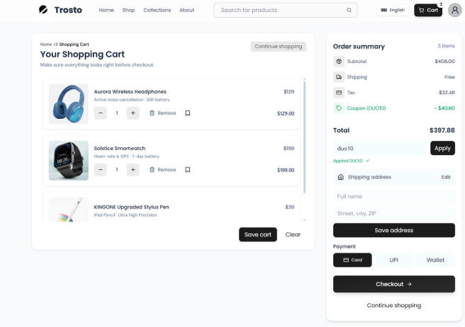
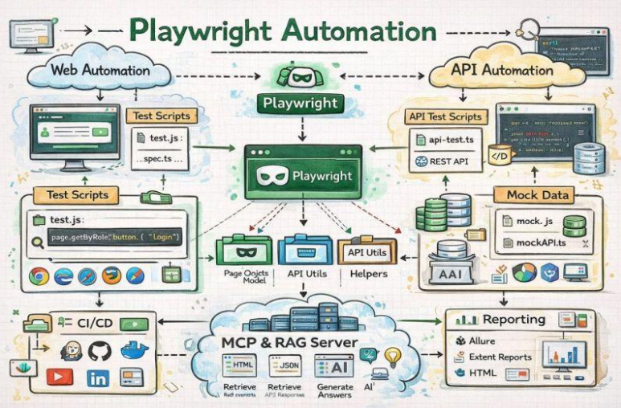

`Prompt:`
```
Act as QA Architect. Your job is designing a process of how to test ECommerce application. I have no clue how to create test automation framework, what all configs it needed, how to maintain page obect model, how to define project structure. How to maintain test data, how to generate test data, how to maintain it.  

I will be using Playwright, Javascript for tests scripting. I will use VS code.

Let's go step-by-step.
```

# E-Commerce Automation Framework -- QA Architect Blueprint

## 1. Objective

Treat this as a real-world QA Architecture assignment. The goal is to
design and build a maintainable, scalable Playwright automation
framework from scratch for an e-commerce application similar to
Flipkart.

We will not jump directly into writing Playwright scripts. First, we
will design the architecture, define standards, establish the project
structure, and then implement everything practically.

### Technology stack

  Component              Technology
  ---------------------- --------------------------
  Programming language   JavaScript
  Automation tool        Playwright
  IDE                    VS Code
  Test runner            Playwright Test
  Design pattern         Page Object Model (POM)
  Test data              JSON / JavaScript
  API testing            Playwright APIRequest
  Test reporting         Playwright HTML Reporter
  Version control        Git / GitHub
  CI/CD                  GitHub Actions (later)

The target is an enterprise-level framework, not just a collection of
automation scripts.

------------------------------------------------------------------------

## 2. Application under test

Assume we have an e-commerce application with the following functional
modules.



### User Management

-   Registration
-   Login / Logout
-   Forgot password

### Product Catalogue

-   Product listing
-   Product details
-   Search
-   Filters and sorting

### Shopping Cart

-   Add products
-   Remove products
-   Update quantity
-   Cart calculations

### Checkout

-   Address management
-   Delivery options
-   Payment
-   Order placement

### Order Management

-   Order history
-   Order tracking
-   Cancellation
-   Returns

### Other Features

-   Wishlist
-   Reviews
-   Offers
-   Notifications

Our responsibility as QA Architects is to design an automation solution
that can test these functionalities reliably.

------------------------------------------------------------------------

## 3. Framework implementation roadmap

We will divide the assignment into 12 steps.

1.  **Define automation strategy**
    -   Identify what to automate, test layers, scope, priorities and
        execution strategy.
2.  **Framework architecture**
    -   Define architecture, design principles, reusable components and
        framework responsibilities.
3.  **Project setup and configuration**
    -   Install Node.js, Playwright, VS Code extensions and configure
        the project.
4.  **Project folder structure**
    -   Design folders for tests, pages, fixtures, test data, utilities,
        API clients and reports.
5.  **Page Object Model**
    -   Design page classes, locators, reusable methods and component
        objects.
6.  **Test data management**
    -   Design test data storage, data generation, test data isolation,
        cleanup and maintenance.
7.  **Framework utilities and fixtures**
    -   Build common functions, browser management, authentication and
        reusable fixtures.
8.  **Implement UI automation**
    -   Automate login, search, product selection, cart and checkout.
9.  **API automation**
    -   Implement API tests and integrate API-based test data setup.
10. **Execution and reporting**
    -   Configure tags, parallel execution, retries, screenshots, traces
        and reports.
11. **CI/CD integration**
    -   Integrate automation with GitHub Actions and configure execution
        pipelines.
12. **Framework maintenance and governance**
    -   Define coding standards, reviews, flaky test management,
        maintenance and quality KPIs.

We will work through these steps incrementally.

------------------------------------------------------------------------

# Step 1 -- Define the automation strategy

Before writing a single Playwright script, answer the important
architectural questions.

## 4. What should we automate?

We should not automate every test case through UI automation. We will
distribute testing across different layers of the test pyramid.

### Automation test pyramid

``` text
             /\
            /  \
           / UI \          Critical user journeys
          /------\
         /  API   \        Business logic and integrations
        /----------\
       / Unit and   \      Individual components and functions
      / Component    \
     /----------------\
```

There should generally be more tests at lower levels and fewer,
high-value tests at the UI level.

### Example: E-commerce test distribution

  Feature / Scenario          Unit   API   UI / E2E
  --------------------------- ------ ----- -----------------------------
  Product price calculation   Yes    Yes   Critical validation
  Login validation            Yes    Yes   Yes
  Product search              No     Yes   Yes
  Product filtering           No     Yes   Critical filters
  Add to cart                 No     Yes   Yes
  Cart quantity calculation   Yes    Yes   Critical journey
  Payment processing          No     Yes   Payment integration journey
  Order placement             No     Yes   Yes
  Order history               No     Yes   Yes
  Form field validation       Yes    Yes   Selected scenarios

**Important architectural decision:** UI automation should primarily
validate critical user journeys and user-facing behavior. It should not
duplicate every API test.

------------------------------------------------------------------------

What will our final framework look like?



------------------------------------------------------------------------


## 5. Identify critical business journeys

As a QA Architect, identify the most important end-to-end journeys.

### Journey 1: Purchase a product

1.  Login
2.  Search for a product
3.  Select a product
4.  Add product to cart
5.  Proceed to checkout
6.  Select delivery address
7.  Complete payment using a test payment method
8.  Verify order confirmation

### Journey 2: Cart management

-   Add multiple products
-   Update quantities
-   Remove products
-   Verify subtotal and total

### Journey 3: Search and product discovery

-   Search by product name
-   Apply filters
-   Sort products
-   Verify search results

### Journey 4: Order management

-   View orders
-   Track order
-   Cancel order
-   Verify refund status

These journeys will become the foundation of our automation suite.

------------------------------------------------------------------------

## 6. Define execution suites

We should not execute the entire automation suite every time a developer
commits code.

Define execution suites based on their purpose and frequency.

  -----------------------------------------------------------------------
  Suite                   Purpose                 When to execute
  ----------------------- ----------------------- -----------------------
  Smoke                   Verify critical         Every deployment
                          functionality           

  Sanity                  Validate impacted       After a specific change
                          functionality           

  Regression              Validate existing       Scheduled / before
                          functionality           release

  E2E                     Validate complete       Nightly / release
                          business journeys       

  API                     Validate backend        CI pipeline
                          functionality           

  Cross-browser           Validate browser        Scheduled / release
                          compatibility           
  -----------------------------------------------------------------------

We will later implement these using Playwright tags and project
configurations.

------------------------------------------------------------------------

## 7. Define framework design principles

Establish these standards before implementation.

  Principle         What it means
  ----------------- -----------------------------------------------------
  Reusability       Avoid duplicate code
  Maintainability   Changes should require minimal updates
  Scalability       Framework should support new modules
  Reliability       Avoid flaky tests
  Independence      Tests should not depend on execution order
  Data isolation    Tests should not interfere with each other's data
  Readability       Anyone on the QA team should understand the scripts
  Configurability   Support multiple environments without code changes

------------------------------------------------------------------------

## 8. Preliminary framework architecture

The framework will have the following layers and responsibilities.

  -----------------------------------------------------------------------
  Layer                               Responsibility
  ----------------------------------- -----------------------------------
  Test layer                          Contains test scenarios and
                                      assertions

  Page layer                          Contains page objects, locators and
                                      page actions

  Fixture layer                       Manages browser, page,
                                      authentication and setup

  Data layer                          Stores and generates test data

  Utility layer                       Contains reusable helper functions

  API layer                           Contains API clients and backend
                                      setup operations

  Configuration layer                 Manages environments, browsers and
                                      execution settings

  Reporting layer                     Captures execution results,
                                      screenshots and traces
  -----------------------------------------------------------------------

We will build this architecture incrementally rather than creating all
folders immediately.

------------------------------------------------------------------------

## 9. Working approach for every step

For every step, we will cover:

1.  **Architecture explanation:** Why are we designing it this way?
2.  **Real-world example:** How would an enterprise QA team implement
    it?
3.  **Folder structure:** Where does each component belong?
4.  **Practical implementation:** Actual JavaScript and Playwright code.
5.  **Architect decisions:** What alternatives exist and why we select
    one.
6.  **Assignment:** A small exercise to verify understanding.

We will not assume that a working e-commerce application is already
available. We will use a suitable practice application or create a small
sample application when needed.

------------------------------------------------------------------------

## 10. Initial technology decisions

  Area                   Proposed decision          Status
  ---------------------- -------------------------- ----------
  Programming language   JavaScript                 Selected
  Automation tool        Playwright Test            Selected
  Design pattern         Page Object Model          Selected
  IDE                    VS Code                    Selected
  Test data              JSON + dynamic test data   Proposed
  Test coverage          API + UI automation        Proposed

### Framework design direction

Start with **JavaScript + Playwright + Page Object Model**. Design the
framework so that it can evolve into a more advanced reusable component
architecture without requiring a complete restructuring.

------------------------------------------------------------------------

## 11. What comes next?

The next step is **Step 2 -- Framework Architecture**.

We will define:

-   The high-level framework architecture
-   How test scripts interact with page objects
-   How fixtures manage browser and test setup
-   How test data flows into test cases
-   How API helpers support UI test setup
-   How configuration controls environments and execution
-   How reporting and debugging fit into the framework

Only after agreeing on the architecture will we create the project and
start implementing it.
